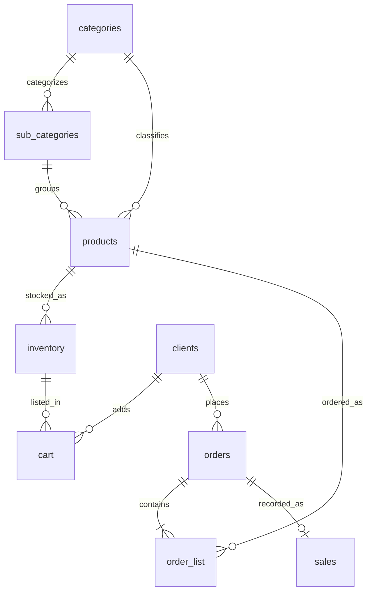

# Database Design — Advanced Book Shop Management System

The academic CSE370 project uses a MySQL/MariaDB relational model that organizes catalogue data, customer activity, stock, orders, and sales.

## Entity relationships

These associations reflect the reference columns in the academic SQL schema.

## Database entities

| Table | Core responsibility |
| --- | --- |
| `products` | Book title, author, description, classification and status |
| `categories`, `sub_categories` | Product taxonomy and grouping |
| `inventory` | Product stock quantity and selling price |
| `clients` | Customer accounts and default delivery address |
| `cart` | Customer selections, quantity and price |
| `orders` | Purchase records, customer, payment method, fulfilment type and status |
| `order_list` | Purchased products, quantity, price and line totals |
| `sales` | Completed order value records |
| `users` | Administrative users and account types |
| `system_info` | Application metadata |

## Primary workflows

1. Catalogue administration maintains categories, book information, stock quantities and prices.
2. Customers browse inventory and add selected quantities to their cart.
3. Checkout creates an order and its individual order lines.
4. Administrative order management tracks payment and fulfilment status.
5. Sales records provide a basis for monitoring transactions.

## Source materials

- [SQL table definitions, primary keys and indexes](../sql/schema.sql)
- [Academic PHP/MySQL application source](https://github.com/Khandaker-Atik/Book_shop_management)
- [Project overview](../README.md)
